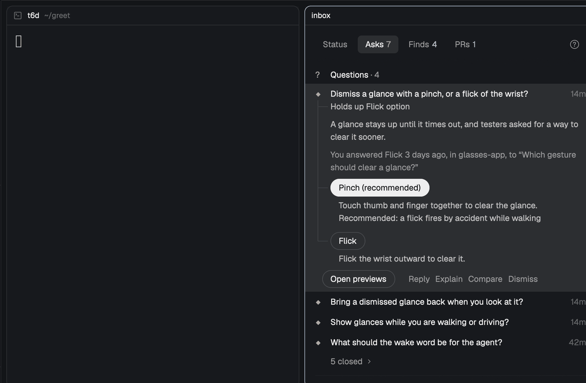

# Inbox

The inbox of your coding agent, drawn in a Herdr pane beside its terminal. It lists what the agent is waiting on you for, what it found along the way and your pull requests, and you answer from the pane. The agent gets each answer as your next message.



## Before you add it

The mod only draws. The inbox itself runs inside Claude Code, Codex or omp, and writes the session the mod reads. Install the inbox in one of them first, as the [README](../README.md#install) describes. Without it the pane says there is no inbox in the terminal.

The mod runs commands and touches files, all on this computer:

- It reads the session file the inbox writes under `<app home>/inbox/sessions/`.
- It writes press files, collapse files and look reports under the same folder, and sets a label on the terminal, which wakes the agent's host to read them.
- It runs `hc` to set that label, and your system's open and copy commands when you press an Open or Copy button.
- It makes no network request. The pull request list comes from `gh`, which the agent's host runs.

You do not need to copy the mod by hand. Type `/inbox` in Claude Code or omp inside a Herdr terminal. The first time, it asks "Install the inbox's Herdr mod?" and copies `main.js` and `mod.json` into `<app home>/mods/inbox/`. Each later start of the inbox replaces an older copy. A `mods/inbox` that is a link, or that you edited, is never written.

To copy it yourself, put `mods/inbox/` from this folder into `<app home>/mods/`.

The mod has no place in any layout. Open it with `/inbox`, or split a pane for it:

```
herdr-app do pane.split '{"direction":"right","pane":"<pane id>","mod":"inbox"}'
```

Take the pane id from `herdr-app ls`. The Codex CLI has no `/inbox`, so use this command there.

## What you see

One panel with a row of tabs at the top and a scrolling list below it.

- **Status** shows the goal, its milestones and what is open, running and finished.
- **Asks** shows each question and task the agent is waiting on, with a button for every answer.
- **Finds** shows what the agent noticed and left for you, such as a bug or a follow-up.
- **PRs** shows your pull requests with their checks and review threads, and a Refresh button.
- **Help** replaces the tabs with the keys and the marks.

Asks, Finds and PRs show a count. A button you press disappears until the agent has your answer.

## How it behaves

- **It follows your focus.** The panel shows the inbox of the terminal you last focused in its tab, and keeps it while the panel itself has focus. A shell terminal reads "No inbox in this terminal", and an ended session reads as ended.
- **Every button works.** A press writes a file for the host. The host applies it and the row shows its result. A press nobody takes within 15 seconds reads as not applied.
- **Keys.** ← and → switch tabs, `j` and `k` move between rows, `z` folds a row, `u` undoes the last close, and Escape gives the keys back to the terminal.
- **Updates.** The mod reads the session again when its folder changes and every 10 seconds, and redraws ages each minute.
- **Both themes.** It takes its colors from Herdr's theme and works from 280 px wide.

## Built from

- One mod, `mods/inbox/`: `mod.json` (`{ "place": "none" }`) and `main.js`, a bundle that Bun builds from `herdr/src` and the inbox's shared code in `core/`. Do not edit it. `bun build.ts` in `herdr/` rebuilds it.
- `herdr`: the focus, panes, terminal labels, `watchFolder`, file reads and writes, `exec` and `hc`. `gpui-kit` and `gpui-base` draw the panel.
- No art and no layout.

## Watch out

- **Herdr kills a draw that takes 50 ms.** The mod keeps each draw short by building its list once per read and reusing it.
- **Herdr does not reload a mod whose folder is a link.** Copy the files in as a real folder.
- **The panel is empty without a host.** A host outside a Herdr terminal publishes nothing, and a terminal with `HERDR_PANE_ID` set reports through the multiplexer instead.

## Done when

- `herdr-app check mods/inbox` passes.
- With the inbox running in a Herdr terminal, `/inbox` opens this panel to the right of the terminal.
- Answering a question in the panel gives the agent your answer as a message, and the row shows its result.
- Focusing a second terminal switches the panel to that terminal's inbox.
- The panel draws in Herdr's light and dark themes.
